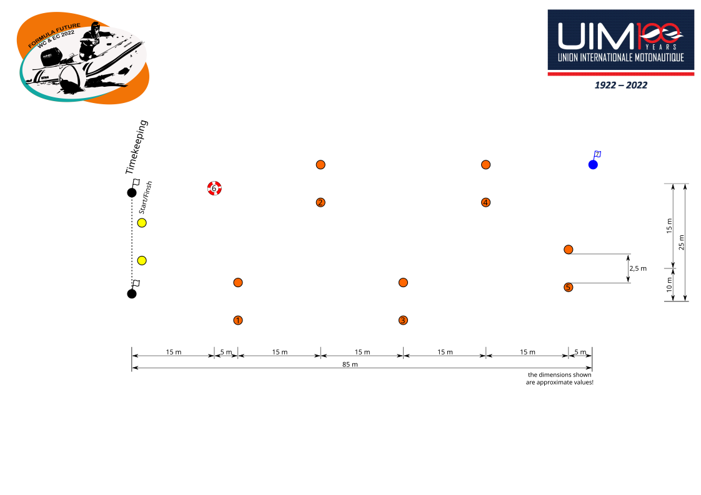
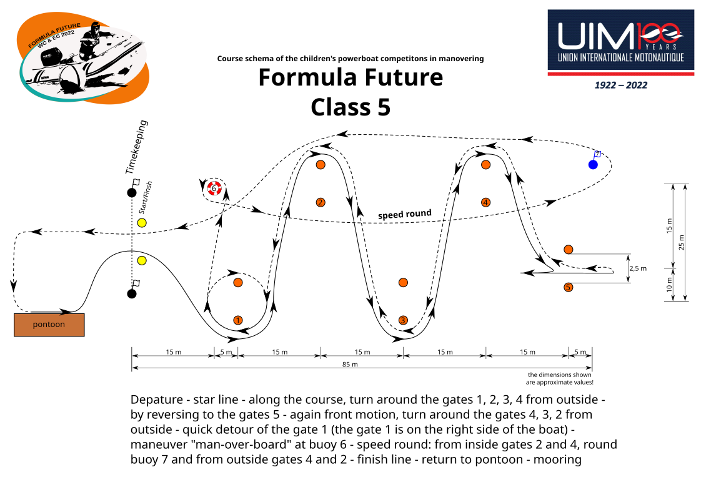
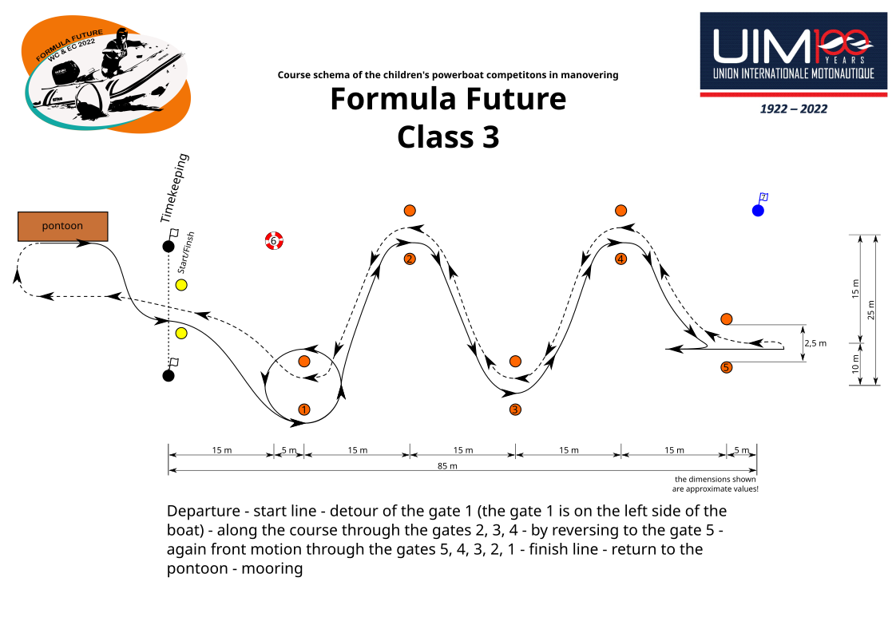

# Course Layout

[Deutsche Version](README.md)

The course drawings by [Matthias Kerk](https://github.com/Motorbootslalom/Parcours) are licensed under a [Creative Commons Attribution-ShareAlike 4.0 International License](http://creativecommons.org/licenses/by-sa/4.0/).

## Pontoon bottom

[[SVG](dist/en/pontoon_bottom/Class1.svg)]
[[PNG](dist/en/pontoon_bottom/Class1.png)]
[[EPS](dist/en/pontoon_bottom/Class1.eps)]
[[PDF](dist/en/pontoon_bottom/Class1.pdf)]

[[SVG](dist/en/pontoon_bottom/Class2.svg)]
[[PNG](dist/en/pontoon_bottom/Class2.png)]
[[EPS](dist/en/pontoon_bottom/Class2.eps)]
[[PDF](dist/en/pontoon_bottom/Class2.pdf)]

[[SVG](dist/en/pontoon_bottom/Class3.svg)]
[[PNG](dist/en/pontoon_bottom/Class3.png)]
[[EPS](dist/en/pontoon_bottom/Class3.eps)]
[[PDF](dist/en/pontoon_bottom/Class3.pdf)]

[[SVG](dist/en/pontoon_bottom/Class4.svg)]
[[PNG](dist/en/pontoon_bottom/Class4.png)]
[[EPS](dist/en/pontoon_bottom/Class4.eps)]
[[PDF](dist/en/pontoon_bottom/Class4.pdf)]

[[SVG](dist/en/pontoon_bottom/Class5.svg)]
[[PNG](dist/en/pontoon_bottom/Class5.png)]
[[EPS](dist/en/pontoon_bottom/Class5.eps)]
[[PDF](dist/en/pontoon_bottom/Class5.pdf)]

[[SVG](dist/en/pontoon_bottom/ClassDolphin.svg)]
[[PNG](dist/en/pontoon_bottom/ClassDolphin.png)]
[[EPS](dist/en/pontoon_bottom/ClassDolphin.eps)]
[[PDF](dist/en/pontoon_bottom/ClassDolphin.pdf)]

[[SVG](dist/en/pontoon_bottom/Parcours.svg)]
[[PNG](dist/en/pontoon_bottom/Parcours.png)]
[[EPS](dist/en/pontoon_bottom/Parcours.eps)]
[[PDF](dist/en/pontoon_bottom/Parcours.pdf)]

## Pontoon top

[[SVG](dist/en/pontoon_top/Class1.svg)]
[[PNG](dist/en/pontoon_top/Class1.png)]
[[EPS](dist/en/pontoon_top/Class1.eps)]
[[PDF](dist/en/pontoon_top/Class1.pdf)]

[[SVG](dist/en/pontoon_top/Class2.svg)]
[[PNG](dist/en/pontoon_top/Class2.png)]
[[EPS](dist/en/pontoon_top/Class2.eps)]
[[PDF](dist/en/pontoon_top/Class2.pdf)]

[[SVG](dist/en/pontoon_top/Class3.svg)]
[[PNG](dist/en/pontoon_top/Class3.png)]
[[EPS](dist/en/pontoon_top/Class3.eps)]
[[PDF](dist/en/pontoon_top/Class3.pdf)]

[[SVG](dist/en/pontoon_top/Class4.svg)]
[[PNG](dist/en/pontoon_top/Class4.png)]
[[EPS](dist/en/pontoon_top/Class4.eps)]
[[PDF](dist/en/pontoon_top/Class4.pdf)]

[[SVG](dist/en/pontoon_top/Class5.svg)]
[[PNG](dist/en/pontoon_top/Class5.png)]
[[EPS](dist/en/pontoon_top/Class5.eps)]
[[PDF](dist/en/pontoon_top/Class5.pdf)]

[[SVG](dist/en/pontoon_top/ClassDolphin.svg)]
[[PNG](dist/en/pontoon_top/ClassDolphin.png)]
[[EPS](dist/en/pontoon_top/ClassDolphin.eps)]
[[PDF](dist/en/pontoon_top/ClassDolphin.pdf)]

[[SVG](dist/en/pontoon_top/Parcours.svg)]
[[PNG](dist/en/pontoon_top/Parcours.png)]
[[EPS](dist/en/pontoon_top/Parcours.eps)]
[[PDF](dist/en/pontoon_top/Parcours.pdf)]
