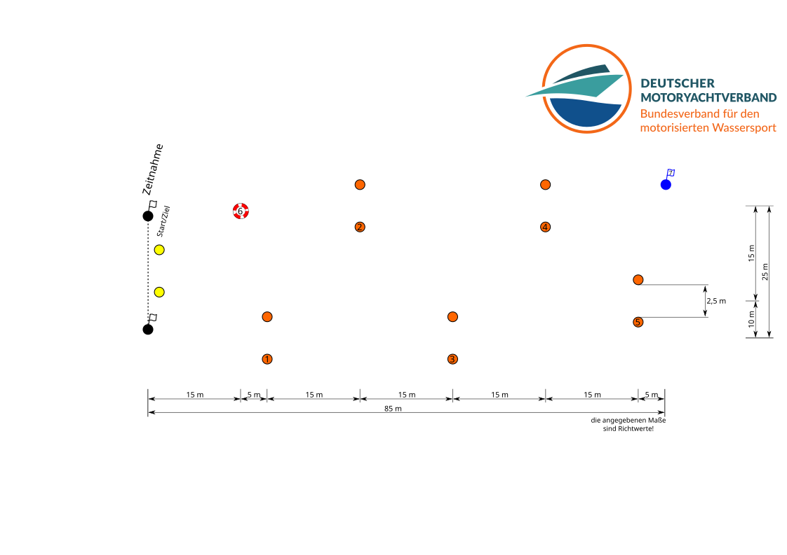
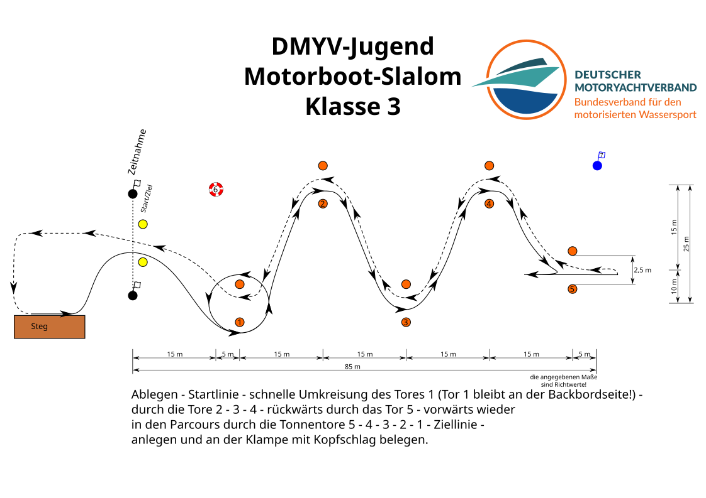
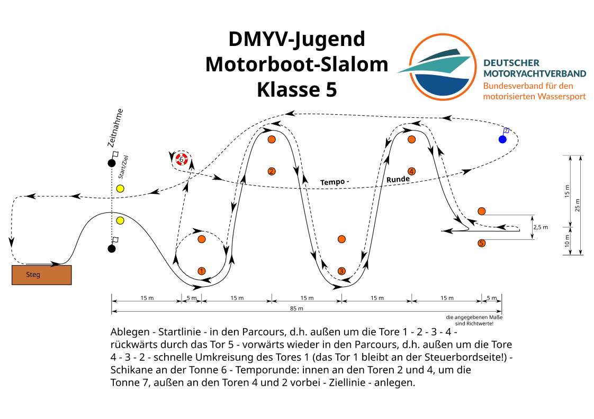
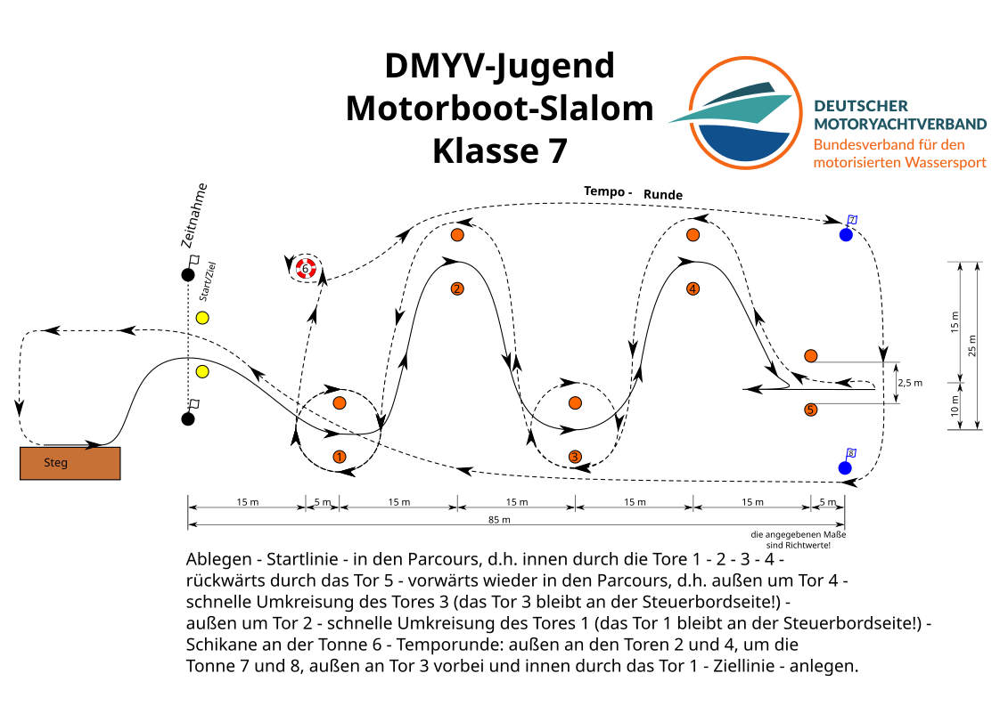
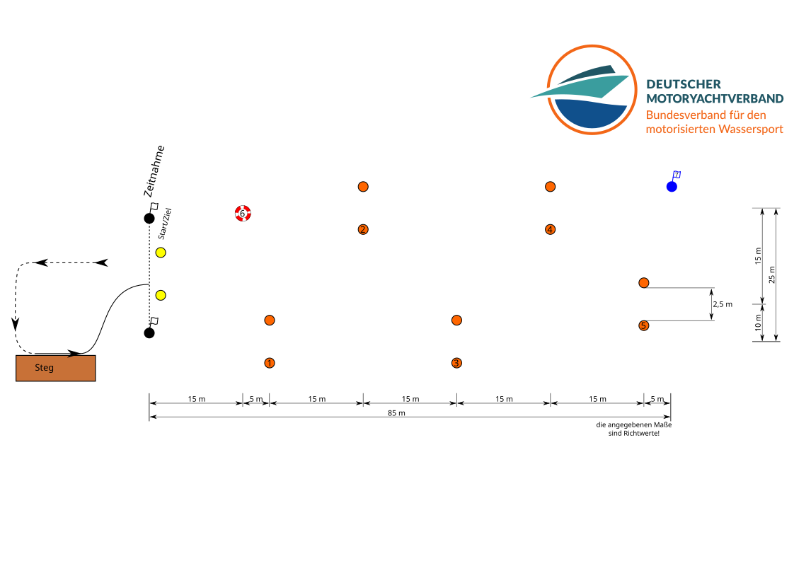
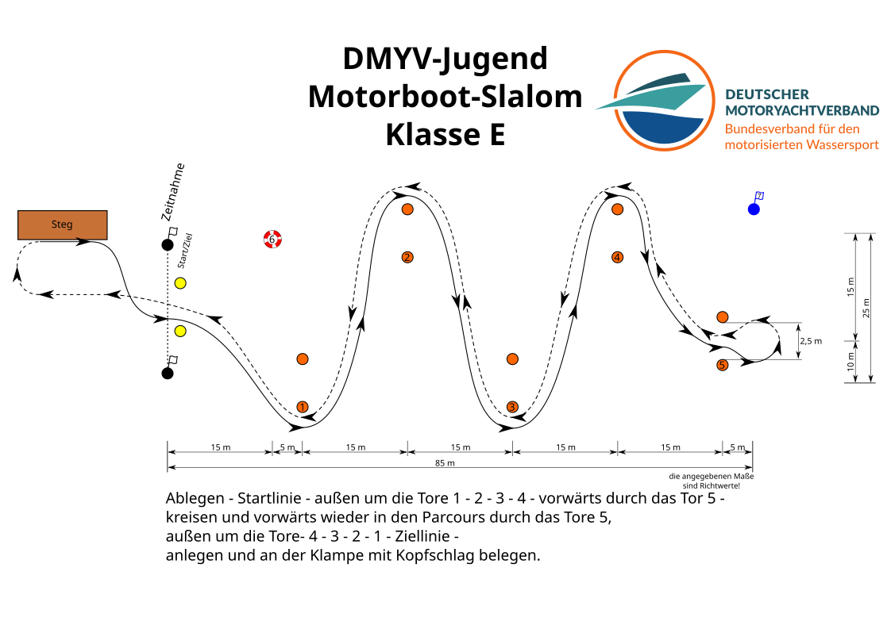
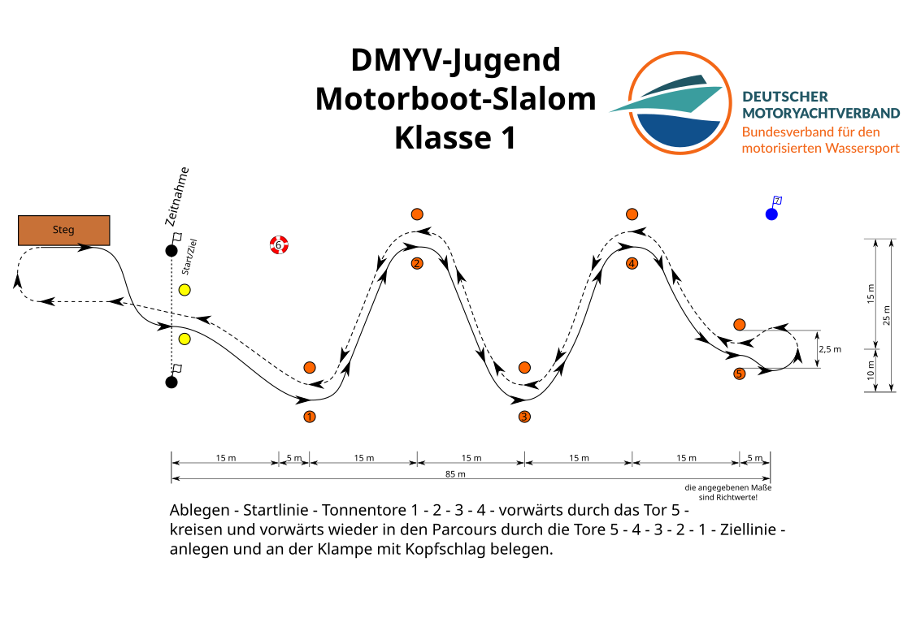
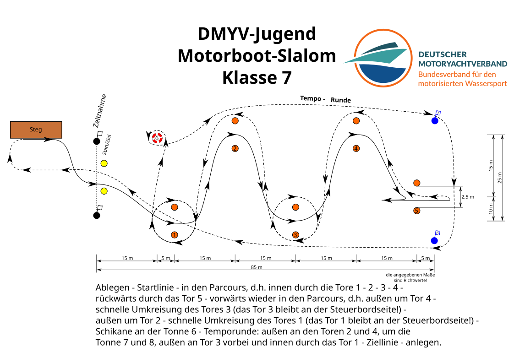
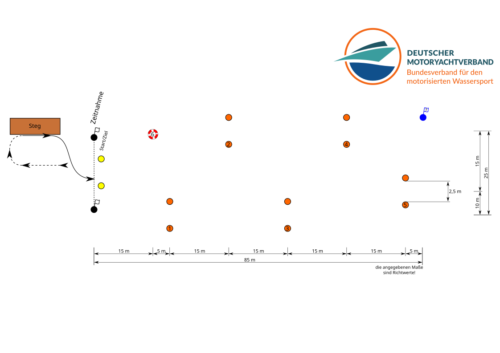
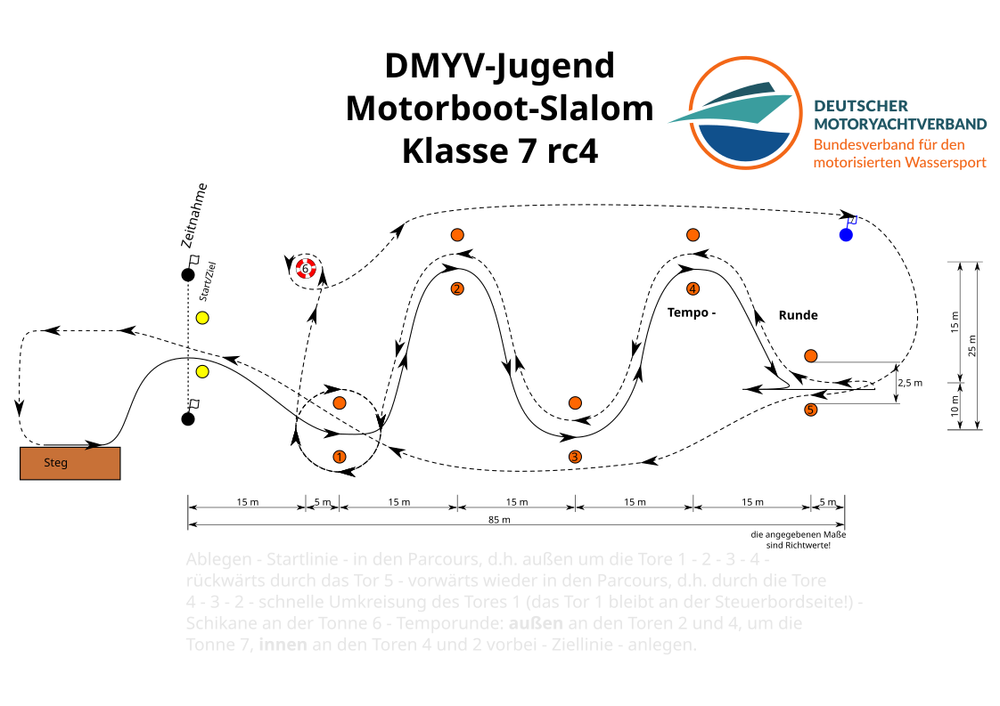

# Parcours

[English version](README.en.md) | [Parallel Slalom](README.parallel.md) | [Übersicht für Wertungslisten (Alcatraz)](README.alcatraz.md)

Die Parcours-Zeichnungen von <a xmlns:cc="http://creativecommons.org/ns#" href="https://github.com/Motorbootslalom/Parcours" property="cc:attributionName" rel="cc:attributionURL">Matthias Kerk</a> sind lizenziert unter einer <a rel="license" href="http://creativecommons.org/licenses/by-sa/4.0/">Creative Commons Namensnennung - Weitergabe unter gleichen Bedingungen 4.0 International Lizenz</a>.

## Steg unten

[[SVG](dist/de/steg_unten/KlasseE.svg)]
[[PNG](dist/de/steg_unten/KlasseE.png)]
[[EPS](dist/de/steg_unten/KlasseE.eps)]
[[PDF](dist/de/steg_unten/KlasseE.pdf)]

[[SVG](dist/de/steg_unten/Klasse1.svg)]
[[PNG](dist/de/steg_unten/Klasse1.png)]
[[EPS](dist/de/steg_unten/Klasse1.eps)]
[[PDF](dist/de/steg_unten/Klasse1.pdf)]

[[SVG](dist/de/steg_unten/Klasse2.svg)]
[[PNG](dist/de/steg_unten/Klasse2.png)]
[[EPS](dist/de/steg_unten/Klasse2.eps)]
[[PDF](dist/de/steg_unten/Klasse2.pdf)]

[[SVG](dist/de/steg_unten/Klasse3.svg)]
[[PNG](dist/de/steg_unten/Klasse3.png)]
[[EPS](dist/de/steg_unten/Klasse3.eps)]
[[PDF](dist/de/steg_unten/Klasse3.pdf)]

[[SVG](dist/de/steg_unten/Klasse4.svg)]
[[PNG](dist/de/steg_unten/Klasse4.png)]
[[EPS](dist/de/steg_unten/Klasse4.eps)]
[[PDF](dist/de/steg_unten/Klasse4.pdf)]

[[SVG](dist/de/steg_unten/Klasse5.svg)]
[[PNG](dist/de/steg_unten/Klasse5.png)]
[[EPS](dist/de/steg_unten/Klasse5.eps)]
[[PDF](dist/de/steg_unten/Klasse5.pdf)]

[[SVG](dist/de/steg_unten/Klasse6.svg)]
[[PNG](dist/de/steg_unten/Klasse6.png)]
[[EPS](dist/de/steg_unten/Klasse6.eps)]
[[PDF](dist/de/steg_unten/Klasse6.pdf)]

[[SVG](dist/de/steg_unten/Klasse7.svg)]
[[PNG](dist/de/steg_unten/Klasse7.png)]
[[EPS](dist/de/steg_unten/Klasse7.eps)]
[[PDF](dist/de/steg_unten/Klasse7.pdf)]

[[SVG](dist/de/steg_unten/Parcours.svg)]
[[PNG](dist/de/steg_unten/Parcours.png)]
[[EPS](dist/de/steg_unten/Parcours.eps)]
[[PDF](dist/de/steg_unten/Parcours.pdf)]

## Steg oben

[[SVG](dist/de/steg_oben/KlasseE.svg)]
[[PNG](dist/de/steg_oben/KlasseE.png)]
[[EPS](dist/de/steg_oben/KlasseE.eps)]
[[PDF](dist/de/steg_oben/KlasseE.pdf)]

[[SVG](dist/de/steg_oben/Klasse1.svg)]
[[PNG](dist/de/steg_oben/Klasse1.png)]
[[EPS](dist/de/steg_oben/Klasse1.eps)]
[[PDF](dist/de/steg_oben/Klasse1.pdf)]

[[SVG](dist/de/steg_oben/Klasse2.svg)]
[[PNG](dist/de/steg_oben/Klasse2.png)]
[[EPS](dist/de/steg_oben/Klasse2.eps)]
[[PDF](dist/de/steg_oben/Klasse2.pdf)]

[[SVG](dist/de/steg_oben/Klasse3.svg)]
[[PNG](dist/de/steg_oben/Klasse3.png)]
[[EPS](dist/de/steg_oben/Klasse3.eps)]
[[PDF](dist/de/steg_oben/Klasse3.pdf)]

[[SVG](dist/de/steg_oben/Klasse4.svg)]
[[PNG](dist/de/steg_oben/Klasse4.png)]
[[EPS](dist/de/steg_oben/Klasse4.eps)]
[[PDF](dist/de/steg_oben/Klasse4.pdf)]

[[SVG](dist/de/steg_oben/Klasse5.svg)]
[[PNG](dist/de/steg_oben/Klasse5.png)]
[[EPS](dist/de/steg_oben/Klasse5.eps)]
[[PDF](dist/de/steg_oben/Klasse5.pdf)]

[[SVG](dist/de/steg_oben/Klasse6.svg)]
[[PNG](dist/de/steg_oben/Klasse6.png)]
[[EPS](dist/de/steg_oben/Klasse6.eps)]
[[PDF](dist/de/steg_oben/Klasse6.pdf)]

[[SVG](dist/de/steg_oben/Klasse7.svg)]
[[PNG](dist/de/steg_oben/Klasse7.png)]
[[EPS](dist/de/steg_oben/Klasse7.eps)]
[[PDF](dist/de/steg_oben/Klasse7.pdf)]

[[SVG](dist/de/steg_oben/Parcours.svg)]
[[PNG](dist/de/steg_oben/Parcours.png)]
[[EPS](dist/de/steg_oben/Parcours.eps)]
[[PDF](dist/de/steg_oben/Parcours.pdf)]

## Alte Klasse

## Entwürfe für Klasse 7

## Anpassungen für andere Vereine

### Anpassungen für den [WSC "Möwe" Oranienburg e.V.](http://www.moewejugend.de)

