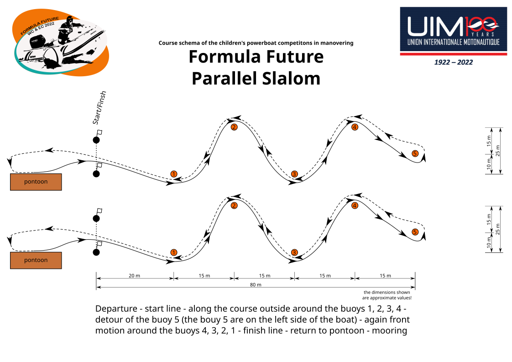
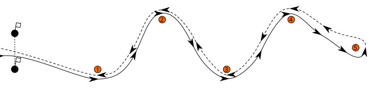
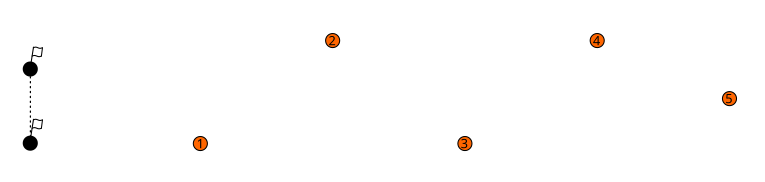

# Parallel Slalom

[Zurück zur Hauptseite](README.md)

Parcours-Zeichnung für den Parallel-Slalom.

## Pontoon bottom

[[SVG](dist/parallel/en/pontoon_bottom/ParallelSlalom.svg)]
[[PNG](dist/parallel/en/pontoon_bottom/ParallelSlalom.png)]
[[EPS](dist/parallel/en/pontoon_bottom/ParallelSlalom.eps)]
[[PDF](dist/parallel/en/pontoon_bottom/ParallelSlalom.pdf)]

[[SVG](dist/parallel/en/pontoon_bottom/Parcours.svg)]
[[PNG](dist/parallel/en/pontoon_bottom/Parcours.png)]
[[EPS](dist/parallel/en/pontoon_bottom/Parcours.eps)]
[[PDF](dist/parallel/en/pontoon_bottom/Parcours.pdf)]

## Eine Bahn für Wertungslisten (Alcatraz)

Für die Wertungslisten und die Erfassung auf Geräten genügt eine Bahn. Die Zeichnung ist
schematisch: Wie die beiden Bahnen und der Steg zueinander liegen, ist an jedem Ort anders.
Darum zeigt diese Ausgabe nur Bahn A (die obere der Zeichnung) und lässt Steg, Logos, Titel,
Beschreibung, Maße und die sprachabhängige Beschriftung weg. Die Fahrlinien enden links vor
der Startlinie, an derselben Stelle wie bei den [Alcatraz-Bildern der Klassen](README.alcatraz.md).
Den Ausschnitt legt der Rahmen `A_Export_Area` in der ausgeblendeten Ebene „Export Area“ fest.

[[SVG](dist/parallel/alcatraz_Parcours/ParallelSlalom.svg)]
[[PNG](dist/parallel/alcatraz_Parcours/ParallelSlalom.png)]
[[EPS](dist/parallel/alcatraz_Parcours/ParallelSlalom.eps)]
[[PDF](dist/parallel/alcatraz_Parcours/ParallelSlalom.pdf)]

[[SVG](dist/parallel/alcatraz_Parcours/Parcours.svg)]
[[PNG](dist/parallel/alcatraz_Parcours/Parcours.png)]
[[EPS](dist/parallel/alcatraz_Parcours/Parcours.eps)]
[[PDF](dist/parallel/alcatraz_Parcours/Parcours.pdf)]

## IDs

Alles, was zu einer Bahn gehört, beginnt in der ID mit ihrem Buchstaben: `A_` für die obere,
`B_` für die untere Bahn. Für Bahn B gelten dieselben Namen mit `B_` (ohne `B_Export_Area`).
Die Ausgabe „eine Bahn“ entfernt alles mit `B_`.

| ID | Bedeutung |
|---|---|
| `A_Boje1` … `A_Boje5` | Bojen 1 bis 5 (orange) |
| `A_Nummer_Boje1` … `A_Nummer_Boje5` | Ziffern in den Bojen |
| `A_StartZiel` | Start- und Ziellinie: Gruppe aus den beiden Bojen und der gepunkteten Linie |
| `A_StartZiel_oben`, `A_StartZiel_unten` | die schwarzen Bojen der Start- und Ziellinie, oben und unten in der Zeichnung |
| `A_StartZiel_Linie` | die gepunktete Linie zwischen ihnen |
| `A_StartZiel_oben_Flagge`, `A_StartZiel_unten_Flagge` | die Fähnchen an diesen Bojen |
| `A_Fahrlinie_hin` | Hinweg bis um Boje 5 (durchgezogen) |
| `A_Fahrlinie_rueck` | Rückweg ab Boje 5 (gestrichelt) |
| `A_Steg`, `A_Steg_Beschriftung` | Steg und seine Beschriftung „pontoon“ |
| `A_Abmessung` | Maße quer zur Bahn (10 m, 15 m, 25 m) |
| `A_Export_Area` | Ausschnitt der Ausgabe „eine Bahn“ |
| `Titel`, `Beschreibung` | Überschrift und Ablauf (für beide Bahnen) |
