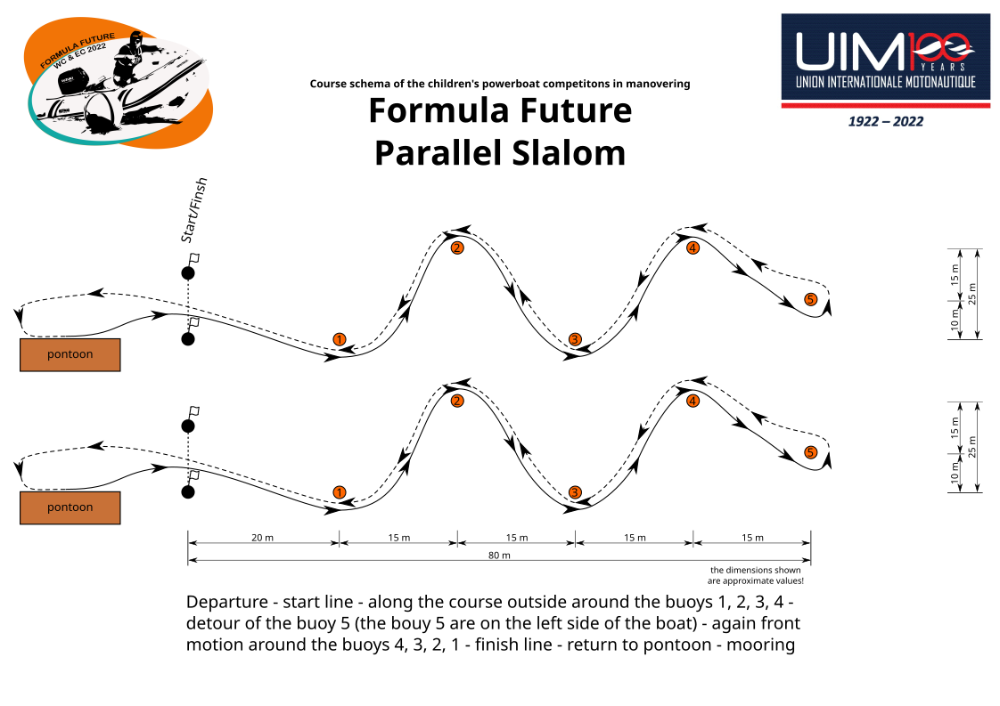

# Parallel Slalom

[Zurück zur Hauptseite](README.md)

Parcours-Zeichnung für den Parallel-Slalom.

## Pontoon bottom

[[SVG](dist/parallel/en/pontoon_bottom/ParallelSlalom.svg)]
[[PNG](dist/parallel/en/pontoon_bottom/ParallelSlalom.png)]
[[EPS](dist/parallel/en/pontoon_bottom/ParallelSlalom.eps)]
[[PDF](dist/parallel/en/pontoon_bottom/ParallelSlalom.pdf)]

[[SVG](dist/parallel/en/pontoon_bottom/Parcours.svg)]
[[PNG](dist/parallel/en/pontoon_bottom/Parcours.png)]
[[EPS](dist/parallel/en/pontoon_bottom/Parcours.eps)]
[[PDF](dist/parallel/en/pontoon_bottom/Parcours.pdf)]
